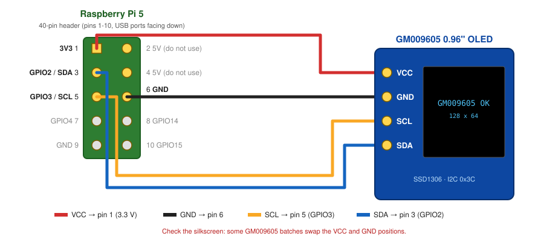

# GM009605 on Raspberry Pi 5

**A from-scratch Linux kernel driver, connection test and wiring guide for the GM009605 0.96″ 128×64 I²C OLED (SSD1306) on the Raspberry Pi 5.**


-blue)


<p align="center">
  
</p>

---

## Features

- **4-wire hookup** with a colour-coded diagram and a pre-power checklist
- **Driver-less connection test** (`test/gm009605_test`): plain C over `/dev/i2c-1`. It verifies ACK, the charge pump, every pixel and text rendering in about 5 seconds
- **Linux kernel module** (`gm009605.ko`):
  - `/dev/gm009605`: a 1 KiB framebuffer you can `cat`, `dd` or `write()` to
  - sysfs controls: `text`, `clear`, `contrast`, `invert`, `flip`, `display_on`, `test_pattern`
  - Device Tree overlay for auto-load at boot, **or** runtime binding with no reboot
  - Safe unbind while the device is open (kref), multi-panel support, blanks the panel on shutdown
- **Scripts** to enable I²C, install or uninstall the driver, and a live system-monitor demo
- Compiles warning-free against the Raspberry Pi 6.18 kernel (`bcm2712`)

## Quick start

```bash
git clone https://github.com/LanTran-01/GM009605-on-Raspi-5.git
cd GM009605-on-Raspi-5

# 0. Wire it up (Pi powered off): VCC→pin 1, GND→pin 6, SCL→pin 5, SDA→pin 3
# 1. Enable I²C (reboot if asked)
sudo scripts/enable-i2c.sh
i2cdetect -y 1                       # expect "3c"

# 2. Test the connection, no driver needed
make check                           # screen shows "GM009605 OK"

# 3. Build and load the kernel driver (runtime, no reboot)
sudo scripts/install-driver.sh --now
echo "Hello, kernel!" | sudo tee /sys/bus/i2c/devices/1-003c/text

# 4. Optional: make it permanent (DT overlay, loads at every boot)
sudo scripts/install-driver.sh && sudo reboot
scripts/sysinfo-demo.sh              # live IP / CPU temp / RAM on the OLED
```

## Wiring at a glance

| GM009605 | Pi 5 pin | Function |
|:---:|:---:|---|
| VCC | 1 | 3.3 V **(not 5 V)** |
| GND | 6 | Ground |
| SCL | 5 | GPIO3 · I2C1 SCL |
| SDA | 3 | GPIO2 · I2C1 SDA |

> ⚠️ Some modules print **VCC and GND in the opposite order**. Always follow the silkscreen on your board.

## Documentation

| # | Guide | Contents |
|:-:|---|---|
| 1 | [Hardware overview](docs/01-hardware.md) | Module specs, SSD1306 memory layout, parts list, why 3.3 V |
| 2 | [Wiring](docs/02-wiring.md) | Pin table, diagram, header orientation, checklist |
| 3 | [Enable I²C](docs/03-enable-i2c.md) | `config.txt`, `i2c-dev`, `i2cdetect` interpretation |
| 4 | [Connection test](docs/04-connection-test.md) | Driver-less test tool, expected output, failure table |
| 5 | [Kernel driver](docs/05-kernel-driver.md) | Architecture, build, runtime vs. overlay loading, sysfs/`/dev` API, code walkthrough |
| 6 | [Troubleshooting](docs/06-troubleshooting.md) | Symptom → cause → fix |

## Repository layout

```
GM009605-on-Raspi-5/
├── common/
│   ├── font5x7.h               5x7 ASCII font (shared by kernel + user space)
│   └── ssd1306.h               SSD1306 command set and panel geometry
├── driver/
│   ├── gm009605.c              Kernel module: I²C client, misc device, sysfs
│   ├── gm009605-overlay.dts    Device Tree overlay (I2C1 @ 0x3C, addr= override)
│   └── Makefile                Kbuild + dtc, install/uninstall targets
├── test/
│   ├── gm009605_test.c         Driver-less connection test over /dev/i2c-N
│   └── Makefile
├── scripts/
│   ├── enable-i2c.sh           Enable I2C1, install deps, add user to group i2c
│   ├── install-driver.sh       Build + load (--now) or install + overlay (persistent)
│   ├── uninstall-driver.sh     Undo everything install-driver.sh did
│   ├── sysinfo-demo.sh         Live system stats on the OLED
│   └── common.sh               Shared helpers (safe config.txt editing with backups)
├── udev/99-gm009605.rules      Non-root access for the i2c group
├── docs/                       Step-by-step guides + wiring diagram
├── Makefile                    make / make test / make driver / make check
└── LICENSE                     GPL-2.0
```

## Build environment

| Component | Version |
|---|---|
| Board | Raspberry Pi 5 Model B Rev 1.0, 8 GB |
| OS | Raspberry Pi OS, Debian 13 "trixie", arm64 |
| Kernel | `6.18.50+rpt-rpi-2712`, `6.18.60+rpt-rpi-2712` |
| Toolchain | GCC (Debian 13), dtc 1.7.2 |

## License

Released under the [GNU General Public License v2.0](LICENSE), the same license as the Linux kernel, which the driver links against.
