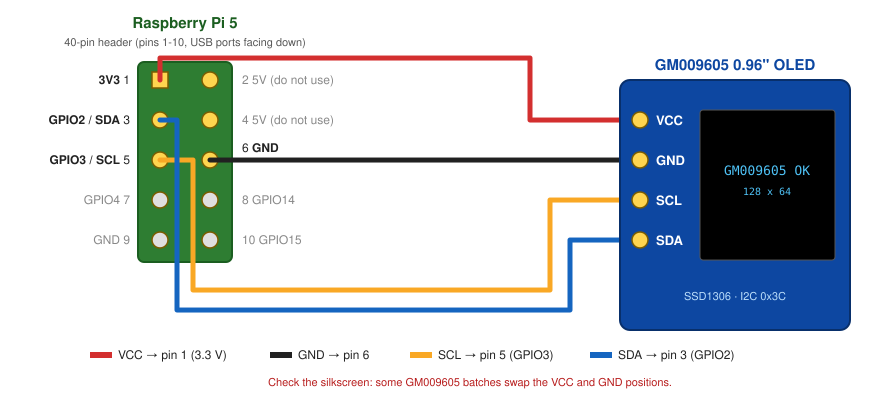

# 2. Wiring

[← Hardware](01-hardware.md) · [Next: Enable I²C →](03-enable-i2c.md)

> **Power off the Pi before wiring:** `sudo poweroff`, wait for the green LED to stop, then unplug USB-C. Hot-plugging I²C devices is usually harmless, but a slipped jumper on a powered header can short 5 V to a GPIO.

## Connection table

| GM009605 pin | Raspberry Pi 5 physical pin | Pi function | Suggested wire colour |
|:---:|:---:|---|---|
| **VCC** | **1** | 3.3 V power | 🔴 red |
| **GND** | **6** (or 9, 14, 20, 25, 30, 34, 39) | Ground | ⚫ black |
| **SCL** | **5** | GPIO3 / I2C1 SCL | 🟡 yellow |
| **SDA** | **3** | GPIO2 / I2C1 SDA | 🔵 blue |



## Finding pin 1

Hold the Pi so the USB and Ethernet ports face **down**. The 40-pin header is then on the right-hand edge:

```
                 inner  outer
                ┌──────┬──────┐
    3V3   ●───▶ │  1 ■ │ ●  2 │  5V      ✗ don't use
    SDA   ●───▶ │  3 ● │ ●  4 │  5V      ✗ don't use
    SCL   ●───▶ │  5 ● │ ●  6 │  GND  ◀───● GND
                │  7 ● │ ●  8 │
                │  9 ● │ ● 10 │
                │   ...│...   │
                └──────┴──────┘
       (USB / Ethernet ports are below this)
```

* Pin 1 has a **square** solder pad on the underside of the board.
* `pinout` (from the `python3-gpiozero` package) draws the header in your terminal.

## Checklist before powering on

- [ ] **VCC and GND match the silkscreen on *your* module.** GM009605 boards come in two pin orders, `GND VCC SCL SDA` and `VCC GND SCL SDA`. Read the labels and don't go by position.
- [ ] VCC is on **pin 1 (3.3 V)**, not pin 2 or 4 (5 V).
- [ ] SDA → pin 3 and SCL → pin 5, not swapped. Swapping them won't damage anything, but nothing will be detected.
- [ ] Every Dupont connector is fully seated, with no bare metal touching a neighbouring pin.
- [ ] Keep the wires short (< 30 cm) for reliable 400 kHz operation.

## Optional: a different address

If two OLEDs share one bus, move the resistor labelled `IIC ADDRESS SELECT` on the back of one module from `0x78` to `0x7A`. That module then answers at `0x3D`. Pass `-a 0x3d` to the test tool and `addr=0x3d` to the overlay.

Next: [Enable I²C →](03-enable-i2c.md)
